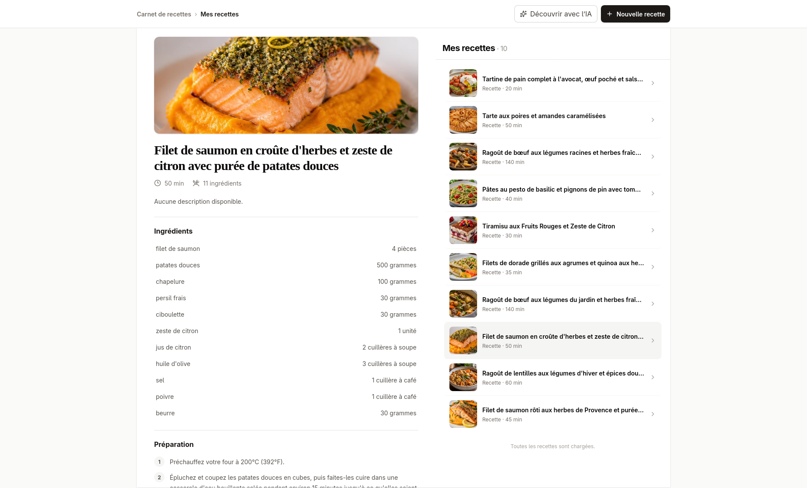

# Recipe Book - Django, Inertia et React

Recipe Book est une application web full-stack pédagogique de gestion de recettes, construite avec Django, SQLite, Inertia.js, React et Vite. Elle permet de consulter, de créer, de modifier et de supprimer des recettes comprenant un nom, une description, des durées, une image, une liste d’ingrédients et des étapes de préparation.



## Objectifs d'apprentissage

### Backend

- structurer une application Django avec des vues, des routes, des modèles et des cas d’utilisation ;
- manipuler l’ORM Django, les migrations et une base SQLite locale ;
- modéliser les relations entre recettes, ingrédients et étapes de préparation ;
- valider les données envoyées au serveur avant leur enregistrement ;
- paginer les recettes côté serveur afin de limiter le nombre d’éléments chargés à chaque requête et de permettre un scroll infini côté frontend ;
- téléverser, valider et servir localement les images de recettes ;
- orchestrer une découverte de recettes avec LangGraph et des modèles accessibles via OpenRouter.

### Frontend

- créer une interface React avec Inertia.js ;
- gérer les formulaires, les erreurs de validation et les messages flash ;
- téléverser et prévisualiser une image de recette ;
- gérer des champs dynamiques pour les ingrédients et les étapes ;
- composer l’interface avec des composants réutilisables pour la liste, le détail, le formulaire et la découverte ;
- charger automatiquement la page suivante de recettes au défilement ;
- utiliser Vite, Tailwind CSS et TypeScript dans une application full-stack.

## Fonctionnalités

- affichage des recettes dans une interface à deux panneaux : un panneau contient la liste défilante des recettes et l’autre affiche l’aperçu détaillé de la recette sélectionnée ;
- chargement progressif de la liste au défilement : le serveur renvoie les recettes par pages et le frontend demande automatiquement la page suivante lorsque l’utilisateur atteint le bas de la liste ;
- affichage du détail d’une recette avec ses ingrédients et ses étapes de préparation ;
- création et modification d’une recette à partir d’un formulaire commun organisé par sections ;
- ajout, remplacement ou suppression d’une image de recette ;
- ajout et suppression dynamiques d’ingrédients et d’étapes dans le formulaire ;
- suppression d’une recette depuis son aperçu ;
- validation des champs côté serveur ;
- messages de confirmation après création, modification et suppression ;
- stockage local des données dans une base SQLite ;
- mode de découverte IA qui prépare jusqu’à dix suggestions de recettes, sauvegardées uniquement après validation explicite.

Le carnet est vide après l’installation : aucune recette de démonstration ni administration Django ne sont incluses.

## Installation

### Prérequis

- Python 3.12 ou supérieur ;
- Node.js 20.19 ou supérieur ;
- pnpm.

### Backend

Créer et activer l’environnement virtuel, puis installer les dépendances Python :

```bash
python -m venv .venv
source .venv/bin/activate
pip install -r requirements.txt
```

Créer le fichier d’environnement local :

```bash
cp .env.example .env
```

Créer la base SQLite et appliquer les migrations :

```bash
python manage.py migrate
```

Les images de recettes sont enregistrées localement dans `media/recipes/` et sont disponibles sous `/uploads/recipes/...` en développement.

### Frontend

Installer les dépendances de l’interface React :

```bash
pnpm install
```

## Démarrage

1. Lancer l’application Django et le serveur Vite :

   ```bash
   pnpm dev
   ```

   L’application est accessible sur <http://127.0.0.1:8000/>.

## Découverte IA

Renseigner `OPENROUTER_API_KEY` dans `.env` pour activer le mode découverte. Une demande prépare dix suggestions au maximum, avec cinq appels simultanés au plus. Chaque suggestion est sauvegardée seulement après action explicite. Sans clé, le mode affiche un message d’indisponibilité sans créer de recette.

Les variables `OPENROUTER_BASE_URL`, `OPENROUTER_MODEL` et `OPENROUTER_IMAGE_MODEL` permettent de modifier les valeurs par défaut.

Le backend orchestre chaque suggestion avec LangGraph : génération d’un nom, contrôle des doublons, réservation temporaire, génération structurée de la recette via LangChain/OpenRouter, image facultative puis libération de la réservation. Dix workflows sont exécutés au plus cinq par cinq. Le flux reste synchrone et conserve les routes Inertia existantes ; aucun traçage LangSmith n’est activé.

## Vérification

```bash
python manage.py check
pnpm typecheck
pnpm build
```
